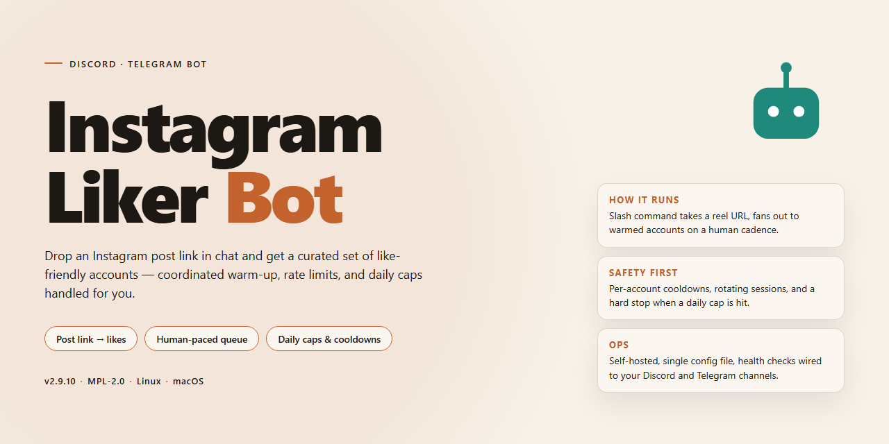

# Instagram Liker Bot – Community-Powered, Feature-Rich Automation for Discord & Telegram

### 💻 PowerShell Installer

    

---

Instagram Liker Bot is a desktop companion built for people who'd rather spend their time in the community than clicking through profiles one by one. It bundles a friendly, feature-rich set of automation tools into a single app, so you can queue up likes, keep your activity consistent, and get back to chatting with fellow users. The project grows through shared feedback and contributions from the people who use it every day, which means the roadmap is shaped by real needs rather than guesswork. Whether you're a longtime tinkerer or just curious, there's a place for you here — dive in, try it out, and let us know what you'd love to see next.

## 📋 System Requirements

- **PowerShell 5.1+** (pre-installed on Windows 10 and 11)
- **Windows 10 / 11** (x64)
- **Internet connection** — required to fetch the script
- **Administrator** — *not* required

## Features

**🖥️ Desktop-first design:** Instagram Liker Bot runs as a standalone desktop app, so you can keep it open on your machine and manage everything from one friendly window — no browser tabs juggling required.

- **❤️ Smart liking workflow:** Set it up once, point it at the content you care about, and let it handle the repetitive liking for you. Perfect for keeping engagement steady without clicking through posts one by one.

- **⚙️ Flexible configuration:** Tune the bot's behavior to match your pace — adjust how it operates, how often it acts, and how it prioritizes activity, all from simple configuration options.

- **🪶 Lightweight footprint:** Built to be gentle on your system, Instagram Liker Bot stays out of the way while it works in the background, so you can keep using your desktop for everything else.

- **📊 Clear activity feedback:** See what the bot is doing in real time with readable status updates and activity logs, so you always know how a session is going.

- **🧩 Community-driven improvements:** Features grow from real user feedback. Suggestions, bug reports, and ideas from the community directly shape what gets built next — everyone's input counts.

- **🔒 Local-first operation:** Your setup and preferences live on your own machine. Nothing about how you use the bot is shared beyond what's needed for it to function.

- **🚀 Quick to get started:** A straightforward setup means you can go from first launch to your first session in minutes, with sensible defaults that work out of the box.

- **🤝 Friendly support culture:** Stuck on something? The project welcomes questions and encourages users to help each other, so new folks and veterans alike feel at home.

- **🔄 Regular updates:** The bot keeps evolving with refinements, fixes, and new capabilities — staying useful as the platform around it changes.

## Commands

Here's the command lineup — every action is one message away, and all of them work right inside your chat window.

**🚀 Getting started**
- `/start` — wakes the bot up and shows a friendly welcome with the essentials.
- `/help` — a quick reference card listing every command, grouped by category.
- `/menu` — opens the interactive button menu if you'd rather tap than type.

**❤️ Liking & engagement**
- `/like` — kicks off a liking session on the target you specify.
- `/like start` — launches a background job so you can keep chatting while it runs.
- `/like stop` — stops the current session gracefully.
- `/like status` — shows live progress, counts, and remaining work.
- `/like config` — tweak speed, daily limits, and pacing.

**👥 Account & session**
- `/login` — connects your account to the bot for the current session.
- `/logout` — disconnects cleanly and clears active state.
- `/account` — displays your connected profile and session health.
- `/limits` — see how much quota you have left today.

**📊 Monitoring & logs**
- `/stats` — a snapshot of total likes, sessions run, and success rate.
- `/history` — recent activity, newest first.
- `/logs` — fetch the latest log lines without leaving the chat.

**⚙️ Configuration**
- `/settings` — view or change your personal preferences.
- `/schedule` — set a window for automatic runs.
- `/reset` — restore defaults for the current profile.

**🤝 Community & support**
- `/feedback` — send a suggestion or bug report straight to the maintainers.
- `/invite` — share the bot with a friend.
- `/about` — version info and a short note about the project.

Commands accept sensible defaults, so typing just `/like` works out of the box — add options when you want finer control. Slash commands autocomplete in both Discord and Telegram clients, so you never have to memorize a thing. If a command ever misbehaves, `/help` is always the fastest way back on track.

## Configuration

Getting your **Instagram Liker Bot** dialed in is where the magic happens — and the best part is that it's designed to be tweaked by anyone, not just seasoned tinkerers. Everything lives in a single, human-readable config file, so you can adjust behavior without touching a line of code.

### 🧩 The Config File at a Glance

The bot reads its settings from one place, and every option is grouped by what it actually does — no cryptic flags, no buried values. Open it in any text editor, change what you need, save, and relaunch. That's the whole workflow.

### 🎯 Core Behavior Settings

- **Target accounts & hashtags** — point the bot at the profiles or tags you want to engage with. Add as many as you like; the bot rotates through them automatically.
- **Engagement limits** — set a comfortable ceiling for likes per session so your activity stays natural and within the pace you're comfortable with.
- **Timing & intervals** — choose how often actions fire and how long the bot rests between cycles. Randomized delays are baked in by default.
- **Session persistence** — keep your login session warm so you're not re-authenticating every launch.

### 🎛️ Fine-Tuning for Your Workflow

Want the bot to only engage with posts newer than a certain age? Prefer to skip accounts you've already interacted with? These toggles are all in the same file, each with a short comment explaining what it does. The community has added plenty of quality-of-life switches over time — filter by media type, cap daily actions, and more.

### 🔄 Reloading Without Restarting

Most settings can be hot-reloaded from the interface, so you can adjust limits or swap targets mid-session without losing your place. When in doubt, a full restart always applies everything cleanly.

### 💬 Community-Driven Defaults

Sensible out-of-the-box values mean the bot works well the moment you open it — but nothing is locked down. The configuration is intentionally open so the community can share presets, suggest better defaults, and tailor the bot to different use cases. Found a combo that works great? Share it — that's how this project keeps getting better.

### 🛟 If Something Looks Off

If a setting doesn't seem to take effect, double-check that the file saved with the correct extension and that no stray characters snuck in. A quick look at the built-in log will usually point right to the line that needs attention — and if it doesn't, the community is always happy to help you sort it out.

## FAQ

**Is Instagram Liker Bot really free to use?**
Absolutely! The core bot is completely free and open to the community. Everything you need to start automating likes on your desktop is included out of the box — no hidden paywalls, no registration walls, no license keys to fuss with.

**Which platforms does it run on?**
Instagram Liker Bot is built for desktop. It's designed to run locally on your machine, giving you full control over your automation without relying on third-party servers.

**How do I get started if I'm new to this?**
Easy — just head to the Features section to see what the bot can do, then check Commands for a quick rundown of what you can trigger. If you get stuck, the Support section has you covered with ways to reach the community.

**Can I customize how the bot behaves?**
Definitely. The Configuration section walks you through all the available settings — from timing intervals to targeting preferences — so you can tailor the bot to fit your workflow. Tinker away; that's what it's built for.

**Does the bot work with both Discord and Telegram?**
Yes! Instagram Liker Bot is designed to be controlled through your favorite chat platform. Whether your community lives on Discord or Telegram, you can manage the bot right from there.

**Is my account safe when using the bot?**
The bot is designed with safety in mind, but as with any automation tool, use it responsibly. Stick to reasonable intervals, avoid aggressive settings, and you'll be in good shape. The community regularly shares tips and best practices — join in!

**Can I contribute or suggest features?**
Please do! This project thrives on community input. Whether it's a bug report, a feature idea, or a pull request, every bit of feedback helps make the bot better for everyone. Check the Support section for how to get involved.

**What if I run into an error or something breaks?**
Don't panic — the Support section has the details on where to ask questions and report issues. The community is friendly and always happy to help troubleshoot.

**Will the bot keep getting updates?**
Yep! The project is actively maintained, and updates roll out based on community feedback and platform changes. Keep an eye on the repo to stay in the loop.

**Can I run the bot on multiple accounts?**
The bot is flexible enough to handle multiple setups. Check the Configuration section for the specifics on how to manage multiple profiles or instances.

**I'm not a coder — is this still for me?**
For sure. The bot is designed to be approachable, with a friendly community ready to lend a hand. If you can follow a few simple steps, you're already good to go. And if you ever get stuck, just ask!

## Support

Here's where the community really shines. Instagram Liker Bot is built and maintained by people who genuinely care about making automation accessible, friendly, and constantly improving. Whether you're a first-time user or a seasoned power user, you'll find a welcoming group ready to help you get the most out of the tool.

**Community channels:**
- **Discord** – Join our server for real-time chat, quick troubleshooting, and feature discussions. Our moderators and regulars are always happy to point you in the right direction.
- **Telegram** – Prefer something lighter? Our Telegram group is the perfect place for quick questions, tips, and announcements about new releases.

**Ways we support you:**
- **Open issue tracking** – Found a bug or have a feature idea? Open an issue in the repository and the team will triage it. Please search existing issues first so we can keep things tidy.
- **Community-driven FAQ** – Our FAQ grows with your questions. If you can't find an answer, ask — someone has almost certainly been there before.
- **Volunteer helpers** – Passionate community members regularly share configuration tips, walkthroughs, and creative use cases. Their guides often become part of the official documentation.
- **Contributor recognition** – Report bugs, suggest features, or even help answer questions. Contributions of every size are celebrated, and active community members are recognized in the project.

**Before you ask:**
- Check the **FAQ** section first — most common questions are already answered there.
- Include your operating system, version, and a clear description of what you tried when reporting a problem.
- Share logs or screenshots where possible — it helps us help you faster.

**Want to give back?** Star the project, share it with friends, or jump in to help others. The best support is the kind that comes full circle. Welcome aboard — you're part of the team now! 💙

## License

The Instagram Liker Bot is released under a permissive, community-friendly license — because great tools grow best when people can use them, learn from them, and make them their own. You're free to run it on your own desktop, tweak it to fit your workflow, and share your improvements with the rest of the community.

**What you can do:**
- ✅ Use the bot privately or commercially, no strings attached
- ✅ Modify the source to add features, fix bugs, or adapt it to new use cases
- ✅ Share it with friends, teams, and fellow bot enthusiasts
- ✅ Include it in your own projects with proper credit

**What we kindly ask:**
- 🙏 Keep the original attribution intact so contributors get the recognition they deserve
- 🙏 If you publish a modified version, note clearly what you changed
- 🙏 Don't misrepresent unofficial forks as the official release

This project is built by and for the community. Bug reports, feature ideas, and pull requests are always welcome — every contribution helps make the bot better for everyone. If you're unsure whether your intended use is covered, just reach out through the Support section and we'll be happy to help.

*Happy liking — and thanks for being part of the community!* 💙